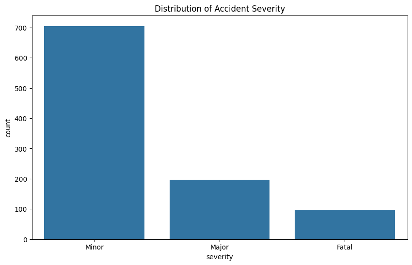
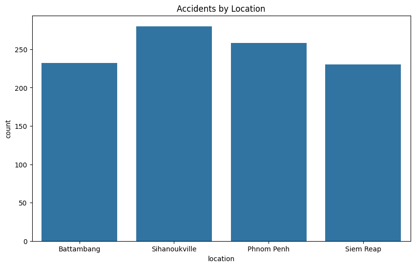
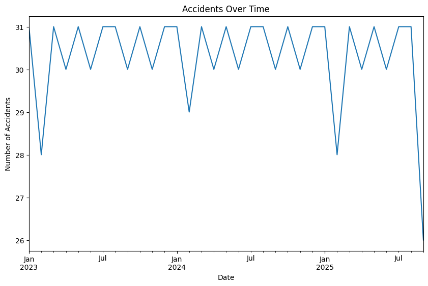

# Traffic Accident Analysis Template (Synthetic Data, Cambodian Cities)

A short exploratory-data-analysis notebook that **generates a synthetic dataset of traffic accidents** labelled with four Cambodian cities, then cleans it, summarises it, plots it and prints a list of recommendations.

> **Important: the data are synthetic.** The notebook creates 1,000 random records with `numpy.random`. It does **not** use real traffic or accident data, so nothing in this project describes real traffic in Cambodia. The repository name is easy to misread; treat this as a practice / template notebook for an EDA workflow.

## Introduction

The notebook walks through a standard EDA workflow: generate data, inspect it, check missing values, compute summary statistics, plot distributions and correlations, and write conclusions.

## Objectives

- Practise the steps of an exploratory analysis with pandas, NumPy, Matplotlib and seaborn.
- Show how severity, location and cause distributions and a correlation matrix can be visualised.

## What the notebook does

| Step | Content |
|---|---|
| 1. Generate data | 1,000 daily records from 2023-01-01: `location` (Phnom Penh, Siem Reap, Battambang, Sihanoukville, chosen uniformly at random), `severity` (Minor / Major / Fatal with fixed probabilities 0.7 / 0.2 / 0.1), `cause` (Speeding, Drunk Driving, Weather, Mechanical Failure, uniform), `vehicles_involved` (1 to 4), `fatalities` and `injuries` derived from severity. Random seed 42 |
| 2. Clean and summarise | Missing-value check (none, by construction) and `describe()` |
| 3. EDA | Count plots of severity, location and cause |
| 4. Correlation | One-hot encoding and a correlation heatmap |
| 5. Visualise | Accidents per month; severity by location |
| 6. Recommendations | A printed list of five conclusions |

## Technologies

Python, pandas, NumPy, Matplotlib, seaborn (Jupyter notebook).

## Recorded outputs

These charts come from the notebook's saved output. They show the random data, **not real accidents**.

| Severity (set by the fixed probabilities) | Accidents by location (uniform random) |
|---|---|
|  |  |



*Figure: one record per day, so the monthly count only reflects the number of days in each month.*

## Findings

**There are no findings about real traffic**, because the data are random. Specifically:

- The severity split reflects the probabilities typed into the code, and the near-equal bars for locations and causes reflect uniform random sampling.
- The five "Conclusion and Recommendations" printed at the end of the notebook are **hard-coded text, not computed from the data**. For example, it states that "Phnom Penh has the highest number of accidents", but the notebook's own location chart shows Sihanoukville highest in the recorded run.

## Limitations

- Synthetic data only; no real data source is used.
- The recommendations are written text and are not supported by the data.
- In the saved notebook, the correlation cell calls `pd(df)` (which would raise an error because `pd` is a module). A heatmap output is recorded, so it was produced by an earlier version of that line (probably `pd.get_dummies`); the stored code is not runnable as written.
- No data files, tests or requirements file; no real dataset is documented.
- The notebook's earlier README contained a copy of the notebook code; it is preserved in [docs/original_readme_pasted_code.md](docs/original_readme_pasted_code.md).

## Folder structure

```
Traffic-Cambodia-/
├── README.md
├── notebooks/Traffic_Cambodian.ipynb
├── docs/original_readme_pasted_code.md   # the previous README (pasted code), kept as found
└── assets/images/                        # charts from the notebook output (synthetic data)
```

## Installation and usage

```bash
pip install pandas numpy matplotlib seaborn jupyter
jupyter notebook notebooks/Traffic_Cambodian.ipynb
```

Library versions were not recorded. The notebook needs no input files because it generates its own data (fix the correlation cell first, for example with `pd.get_dummies(df)`).

## References and acknowledgements

None. To analyse real Cambodian road-safety data, replace the generation step with an authorised dataset and re-derive the conclusions from it.
